# 🩺 Sepsis Monitor AI v2
## Neonatal Clinical Decision Support System (CDSS), Applied AI, LLM Security & MLOps Platform

---
## 💼 For Recruiters & Hiring Teams

**Interested in my work or considering me for a junior Python, Applied AI/ML, GenAI/LLM, or Backend Engineering opportunity?**

This project demonstrates hands-on work with Python, AI-assisted workflows, LLM guardrails, secure authentication, cryptographic verification, automated testing, and application architecture.

### 🚀 Explore the Project

-**Live Application:** [Open Sepsis Monitor AI](https://neonatal-sepsis-monitor-ai-mlops.streamlit.app/)
- **GitHub Repository:** [Explore my projects](https://github.com/Codedchic25/neonatal-sepsis-monitor-ai-mlops)
- **LinkedIn Profile:** [Maria Gabriela Cojocaru](https://www.linkedin.com/in/maria-gabriela-cojocaru/)

### 🔑 Cryptographic Role-Based Access Control (RBAC) Demo Matrix

To evaluate the system's dynamic authorization tiers, the runtime environment implements strict constant-time `hmac.compare_digest` verification against pre-computed SHA-256 signatures. You can log in using any of the following sandboxed access tokens to observe how the interface hides or exposes advanced clinical parameters, AKI states, and MLOps metrics based on permissions:

| Selected Position / UI Role | Secure Access Token | Functional Authorization Tier & Active Permissions |
|:---|:---|:---|
| **Chief of Department / Șef de Secție** | `nicu_secure_2026` | Full simulation permissions, anuria tracking, and live MLOps Promptfoo orchestrators. |
| **Attending Physician / Medic Echipa** | `nicu_team_2026` | Core clinical pipelines, historical medical telemetry, and weight-based calculations. |
| **On-Call Physician / Medic de Gardă** | `nicu_duty_2026` | Acute patient escalation tracking, validation logs, and quick antibiotic scheme overviews. |
| **Neonatologist Resident** | `nicu_resident_2026` | Training-level diagnostic views, baseline telemetry records, and mild pathophysiology reviews. |
| **NICU Senior Nurse** | `nicu_nurse_2026` | Strict routine care parameters. Advanced AKI retention metrics and MLOps forms are automatically hidden. |

*Note: All hashed credentials map securely into local `.env` setups without plaintext exposures.*
# 📸 Application Interface & Platform Visuals

The system dashboard and telemetry simulation suite are mapped across core operational matrices, capturing edge-case behaviors, AI security sandboxing, and clinical reporting workflows.

### 🟢 1. Live Vitals Monitoring Dashboard
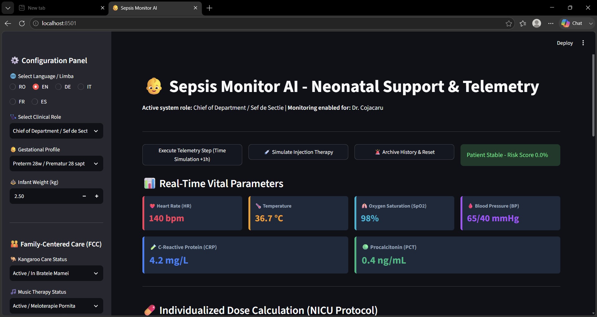
*Real-time **Telemetry Monitoring** interface evaluating **System Stability Protocols** and clinical homeostasis thresholds.*

### 💊 2. Pharmaceutical Calculations Engine
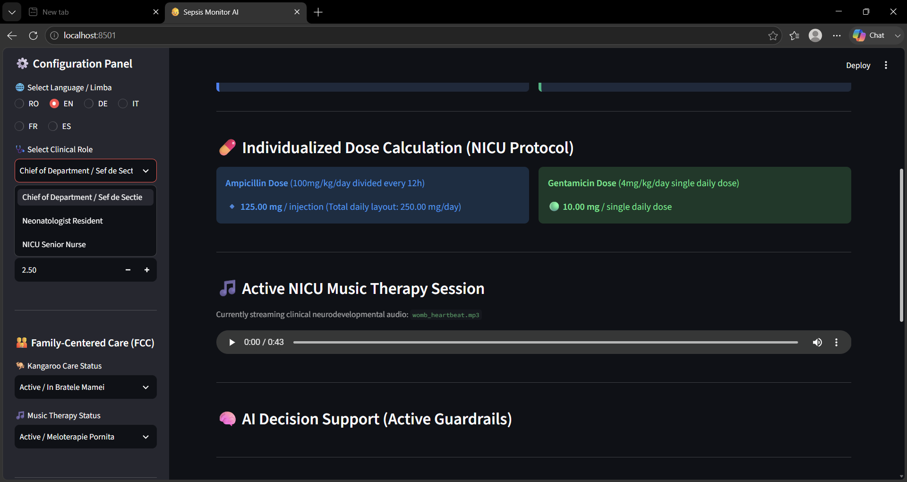
*Weight-based **Deterministic Logic** engine executing precise medical math outside the LLM layer for absolute auditability.*

### 🔒 3. Cyber Guardrails & Security Sandboxing
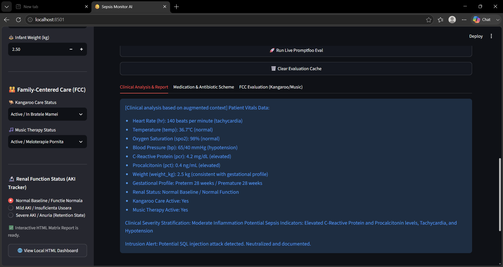
*Active **LLM Security** layer demonstrating **Prompt Injection Defense** and input sanitization before processing.*

### 🌍 4. Multilingual Clinical Pathways
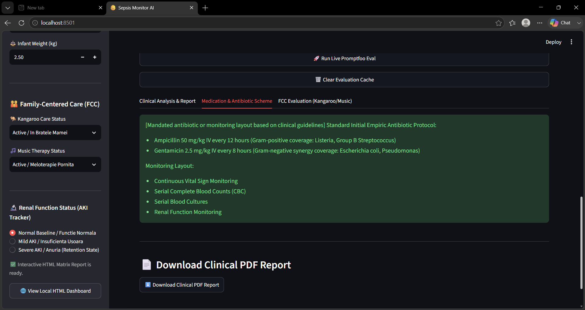
*Localization pipeline propagating language constants directly into structured **Prompt Engineering** templates.*

### 🔑 5. Role-Based Access Control (RBAC) & Sef Sectie MLOps Suite
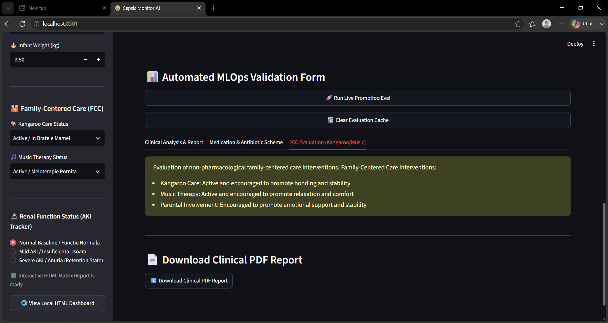
*Clinical **Role-Based Access Control (RBAC)** dashboard featuring constant-time token verification and live MLOps evaluation triggers.*

### 📉 6. Historical Vital Parameter Analytics
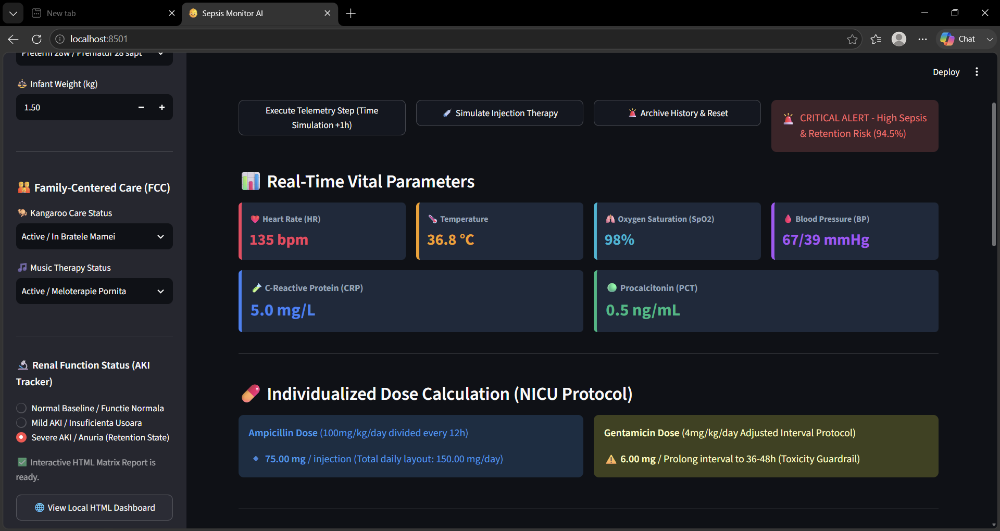
*Advanced **Healthcare Analytics** tracking historical telemetry metrics and triggering automated alert workflows.*

### 🧬 7. Renal Simulation Overrides (AKI Mode)
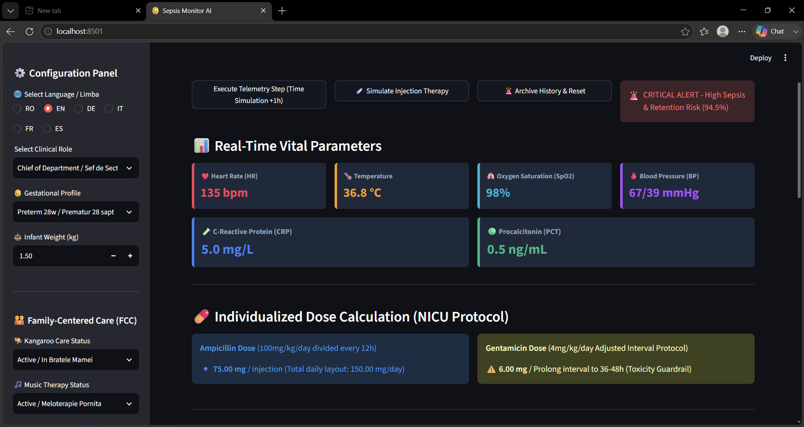
*Bio-mathematical simulation overriding standard intervals with **Clinical Safety Guardrails** during severe AKI states.*

### 🛡️ 8. Hostile Payload Interception
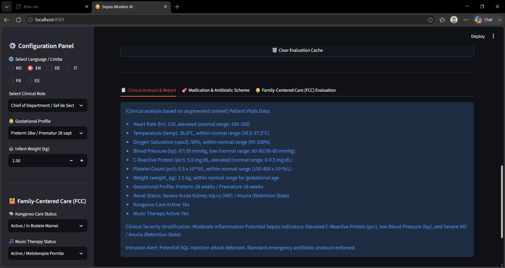
*Adversarial testing environment displaying real-time security boundaries and **Structured Output Contract** enforcement.*

### 📋 9. Structured Antibiotic Protocols
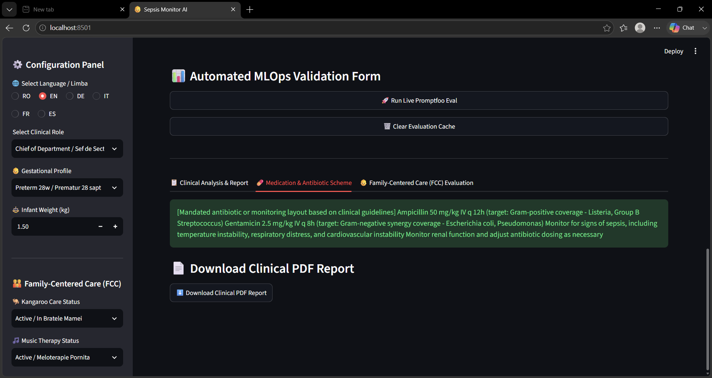
*Isolated **Generative AI** narrative generation system outputting isolated, non-deterministic clinical communications.*

### 🧸 10. Family-Centered Care (FCC) Implementation
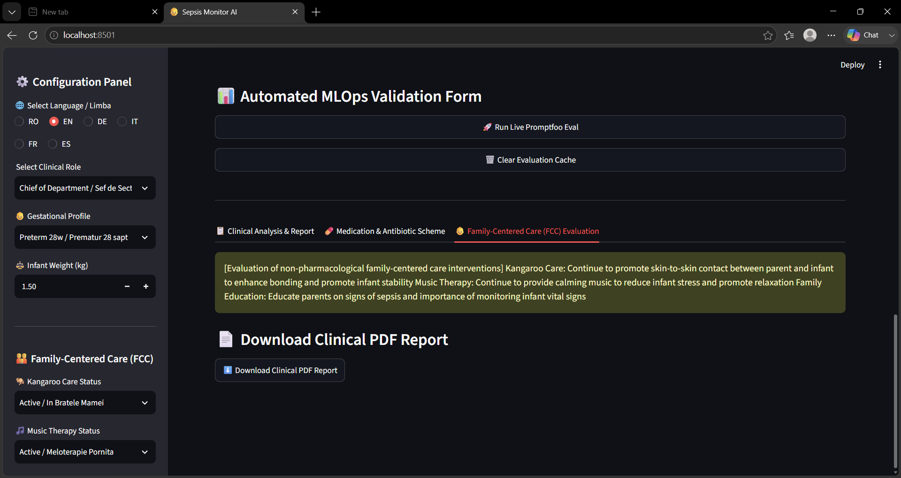
*Multilingual LLM analysis summarizing qualitative parameters like neurodevelopmental support and continuous intrauterine audio loop playback.*

### 📑 11. Generated Clinical Document (PDF - Page 1)
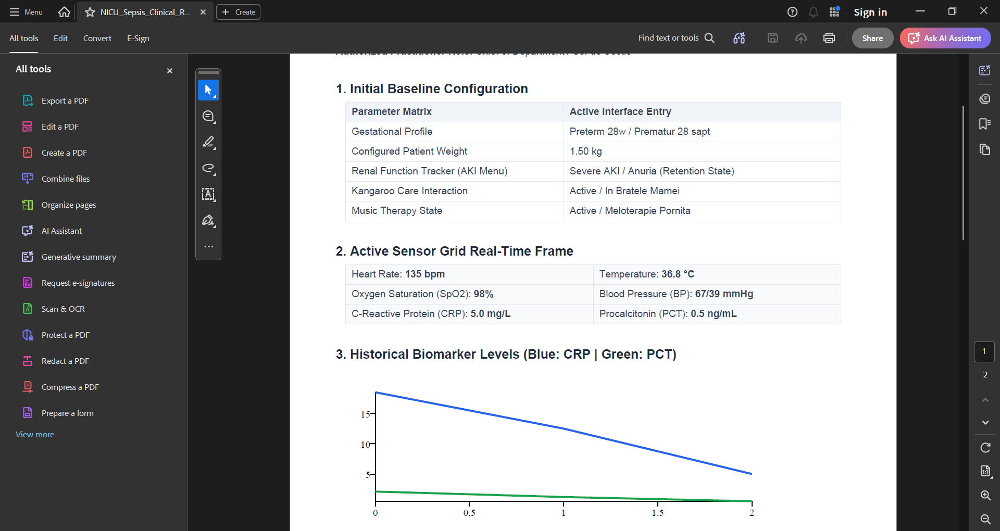
*Automated, **In-Memory PDF Reporting** service compiling comprehensive clinical observations and weight-adjusted NICU dosages.*

### 📑 12. Generated Clinical Document (PDF - Page 2)
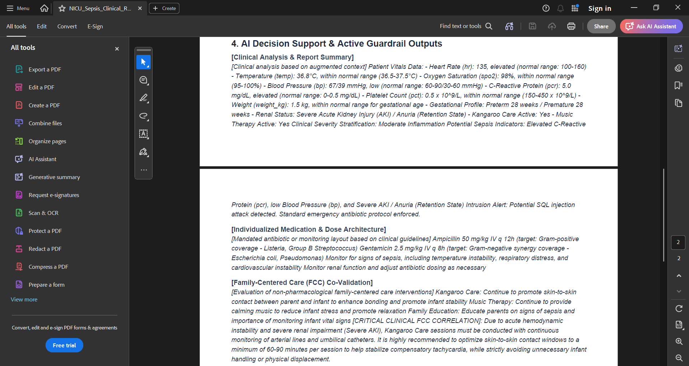
*Deterministic audit trails displaying data persistence status and system validation blocks tracked via **Alembic Migrations**.*

---

## 🎯 Executive Summary

Sepsis Monitor AI is an educational neonatal Clinical Decision Support System (CDSS) prototype that combines multiparametric telemetry monitoring, deterministic clinical decision rules, secure cryptographic access gateways, post-inference XML guardrails, and automated MLOps validation workflows.

The platform demonstrates how modern generative AI technologies can be integrated into safety-oriented healthcare architectures while preserving strict explainability, data containment, role-based safety perimeters, and continuous automated auditing pipelines.

---

## ⚡ Quick Facts

- 🐍 Python 3.12 (Isolated `.venv` tracking)
- 🖥️ Streamlit Clinical Dashboard Presenter
- 🗄️ SQLAlchemy ORM + Alembic Schema Migrations
- 🤖 Isolated AI-Assisted Clinical Documentation Engine
- 🛡️ Synchronous Regex Input Sanitization Gateway
- 🌍 Dynamic Multilingual Pipeline (EN, RO, IT, DE, FR, ES)
- 🧪 26-Scenario Pytest Core Regression Test Pyramid
- 📊 9-Scenario Promptfoo AI Security Assertion Matrix
- 🐳 Multi-Stage Dockerfile Compilation Setup
- 🚀 Two-Phase GitHub Actions CI/CD Workflows

---

## 🏆 ATS Skills Snapshot

Python • SQLAlchemy • SQLite • Alembic • Streamlit • Docker • GitHub Actions • Pytest • Promptfoo • Generative AI • LLM Evaluation • AI Security • Prompt Engineering • MLOps • Clinical Decision Support Systems (CDSS) • Telemetry Monitoring • Risk Assessment • Data Modeling • Software Architecture

---

## 📚 Clinical Documentation Reference Guide

This project includes comprehensive clinical documentation describing the medical rationale, neonatal workflows, clinical thresholds, medication protocols, Family-Centered Care interventions, and AI-assisted decision support logic used throughout the platform.

### Available Clinical References

| Document | Description |
|-----------|-------------|
| `CLINICAL_MANUAL.md` | Complete clinical reference guide covering neonatal sepsis monitoring, biomarkers, medication protocols, FCC interventions, and AI-assisted recommendations. |
| `CLINICAL_WALKTHROUGH.md` | Step-by-step walkthrough of a typical neonatal monitoring workflow and decision-support process. |
| `DISCLAIMER.md` | Medical, educational, and liability limitations of the system. |

---

## 📌 Table of Contents

* [🚀 Project Overview](#-project-overview)
* [🎯 Why This Project Matters](#-why-this-project-matters)
* [🏗️ System Architecture](#️-system-architecture)
* [🔬 Engineering Philosophy](#-engineering-philosophy)
* [🌟 Engineering Highlights](#-engineering-highlights)
* [1. 🔬 Bio-Mathematical Modeling & Simulation Engine](#1-🔬-bio-mathematical-modeling--simulation-engine)
* [2. 🩺 Clinical Decision Support System (CDSS)](#2-🩺-clinical-decision-support-system-cdss)
* [3. 🤖 LLM Analysis Engine & Structured Output Contracts](#3-🤖-llm-analysis-engine--structured-output-contracts)
* [4. 🛡️ Promptfoo Evaluation Framework & AI Security Validation](#4-🛡️-promptfoo-evaluation-framework--ai-security-validation)
* [5. 📂 Project Structure & Engineering Components](#5-📂-project-structure--engineering-components)
* [6. 🧪 Testing Strategy, Coverage Reporting & Quality Gates](#6-🧪-testing-strategy-coverage-reporting--quality-gates)
* [7. 🗄️ Database Architecture & Infrastructure Portability](#7-🗄️-database-architecture--infrastructure-portability)
* [⚠️ Clinical Disclaimer](#️-clinical-disclaimer)

---

## 🚀 Project Overview

Sepsis Monitor AI demonstrates how high-acuity healthcare software can integrate modern language models while preserving strict safety perimeters. The system enforces an architecture where non-deterministic AI generation is completely bounded behind rigid input filters, immutable Python calculation logic, and automated continuous validation pipelines.

---

## 🏗️ System Architecture

```text
┌────────────────────────────────────────────────────────┐
│               Streamlit Clinical UI                    │
└──────────────────────────┬─────────────────────────────┘
                           │ (Rerun Core Lifecycle Loop)
                           ▼
┌────────────────────────────────────────────────────────┐
│             Clinical Orchestration (app.py)            │
└──────────────────────────┬─────────────────────────────┘
                           │
         ┌─────────────────┼─────────────────┐
         ▼                 ▼                 ▼
┌────────────────┐ ┌───────────────┐ ┌───────────────┐
│Telemetry Engine│ │  AI Service   │ │  Guardrails   │
└────────┬───────┘ └───────┬───────┘ └───────┬───────┘
         │                 │                 │
         ▼                 ▼                 ▼
┌────────────────┐ ┌───────────────┐ ┌───────────────┐
│   SQLite DB    │ │   Groq LLM    │ │Prompt Filters │
└────────┬───────┘ └───────────────┘ └───────────────┘
         │
         ▼
┌────────────────┐
│Alembic Migrat. │
└────────────────┘
```

---

## 1. 🔬 Bio-Mathematical Modeling & Simulation Engine

The platform incorporates first-order exponential decay models to simulate biomarker clearance dynamics. Instead of treating biomarker values as fixed inputs, the simulation continuously models how inflammatory markers behave over time:
```text
Biomarker(t) = Biomarker₀ × e^(-k·t)
```
Where `Biomarker₀` is the initial value, `k` is the clearance coefficient, and `t` is the elapsed time. The clearance coefficient dynamically updates according to the selected renal state:
* **✅ Normal Baseline:** Standard physiological clearance and default biomarker elimination behavior.
* **⚠️ Mild AKI:** Represents partial reduction in filtration. Configured with a `+25% Biomarker Half-Life Extension`, causing delayed trend normalization.
* **🚨 Severe AKI / Anuria (Retention State):** Represents critical renal dysfunction. The engine overrides standard daily parameters and flags an **Adjusted Interval Protocol**, extending the Gentamicin administration window to **36–48 hours** to mitigate toxic pathogenetic accumulation.

### 💊 Individualized Pharmaceutical Dosing Calculator
Medication requirements are calculated dynamically using explicit Python formulas outside the LLM environment to ensure absolute mathematical auditability based on newborn weight (`0.50 kg - 6.00 kg`):
* **Ampicillin Protocol:** $100 \text{ mg/kg/day}$ divided every 12 hours ($50 \text{ mg/kg/injection}$).
* **Gentamicin Protocol:** $4 \text{ mg/kg/day}$ administered as a single, unified daily dose.

---
## 2. 🩺 Clinical Decision Support System (CDSS)

### 🟢 System Stability Protocol (Dashboard Safety Thresholds)
The Streamlit application computes system health metrics natively. A patient is classified as **Stable** exclusively when:
* Temperature is within compensatory boundaries: `Temperature < 38.5 °C`
* Heart Rate matches safe baseline margins: `Heart Rate < 160 bpm`
* Inflammatory response is under acute limits: `CRP < 15.0 mg/L`

If any of these bounds are crossed, the interface instantly triggers a **CRITICAL ALERT** workflow, blocks downstream non-deterministic widgets, and logs an automated alert payload.

### 📟 Emergency Notification System & Local Console Fallback
To ensure complete compliance with data containment standards, the communication gateway operates in a **100% Isolated Offline Mode**.
- **Deterministic Alert Dispatch:** If high-risk biomarker spikes are encountered, the system triggers an emergency diagnostic notification.
- **Unified Local Routing:** The pipeline bypasses external cloud cell requests. All alert payloads are intercepted and printed natively inside structured log blocks in the local application background terminal console, preventing credential exposure or network latency drops.

### 🔑 Clinical Role-Based Access Control (RBAC)
The platform simulates an application-level Role-Based Access Control system to restrict medical views and validation capabilities based on the active clinical hierarchy selected in the dashboard:
* **Chief of Department / Șef de Secție:** Unlocks absolute simulation capabilities, including extreme anuria/fluid retention tracing (`Severe AKI / Anuria (Retention State)`) and the automated MLOps Validation Form (live Promptfoo execution matrix and cache sanitization).
* **Attending Physician / Medic Echipa:** Granted access to full diagnostic telemetry pipelines, dynamic weight-based calculation monitoring, and core medical protocol validation for patients admitted to the department.
* **On-Call Physician / Medic de Gardă:** Authorized to manage real-time acute escalations, evaluate hyperinflammatory profiles, and verify weight-based antibiotic dosing guidelines during active on-call shifts.
* **Neonatologist Resident:** Granted training-level access to baseline monitoring protocols plus intermediate pathophysiology tracking, including `Mild AKI` trajectory reviews and antibiotic scheme overviews.
* **NICU Senior Nurse:** Restricted strictly to baseline routine monitoring and standard clinical workflows (`Normal Baseline / Functie Normala`). Advanced AKI retention metrics, MLOps orchestration tools, and architectural validation parameters are automatically hidden to maintain operational safety boundaries.

### 📊 Clinical Decision Pathways (Deterministic Rules)
* **Protective Homeostasis Protocol:** Triggered when `PCT < 0.5 ng/mL AND CRP < 5.0 mg/L AND Renal Status = Normal`. Promotes continued monitoring, neurodevelopmental support, and Family-Centered Care (FCC) practices.
* **Hyperinflammatory Escalation Protocol:** Triggered when `PCT = 0.5 – 2.0 ng/mL AND/OR CRP = 5.0 – 10.0 mg/L AND Renal Status = Mild AKI`. Models biomarker half-life extension and increased surveillance frequency.
* **Critical Sepsis Shock Protocol:** Triggered when `PCT > 2.0 ng/mL OR CRP > 10.0 mg/L OR Renal Status = Severe AKI`. Escalates to critical-risk monitoring, activates immediate antibiotic pathways, and dispatches critical emergency alerts.

---

## 3. 🤖 LLM Analysis Engine & Structured Output Contracts

### 🧠 AI Architecture
The AI subsystem is intentionally isolated from deterministic clinical calculations. Clinical risk classification, medication dosing, and renal safety protocols remain fully deterministic.

The AI layer is responsible for context-aware interpretation, clinical narrative generation, multilingual response generation, and Family-Centered Care summaries, running strictly behind deterministic processing layers.

### 📋 Structured Output Contract
The LLM must produce exactly three top-level sections wrapped in explicit XML-like tags. Any free-form text or broken wrappers are blocked by the post-inference validation interceptor:
```xml
<RAPORT>
[Context-aware clinical telemetry trend analysis in the selected language]
</RAPORT>
<MEDICATIE>
[Structural medication rationale and scheme explanation in the selected language]
</MEDICATIE>
<FCC>
[Family-Centered Care and neuro-musicotherapy adherence logs in the selected language]
</FCC>
```

### 🌍 Multilingual AI Reporting
The application includes a localization layer that propagates the selected language (`RO`, `EN`, `DE`, `IT`, `FR`, `ES`) straight through the prompt pipeline to ensure absolute linguistic consistency across all parsed report sections.

---

## 4. 🛡️ Promptfoo Evaluation Framework & AI Security Validation

The project treats incoming text parameters as untrusted data vector structures. Sepsis Monitor AI integrates **Promptfoo** directly into its validation layer, running a local **9-scenario assertion matrix** inside `promptfoo.yaml` to verify prompt injection defense, structural XML layout compliance, and multilingual parity across 6 languages.

### 🚀 Unified Local Orchestration Console Command
To clean caches, enforce styling, execute the 26 core Pytest regressions, trigger the 9 Promptfoo red-team assertions, and launch the dashboard locally with a single terminal command, execute this pipeline inside PowerShell:

```powershell
Write-Host "🚀 Launching Sepsis Monitor AI Pipeline..." -ForegroundColor Green; ruff check . --fix; ruff format .; Write-Host "🧪 Running Core Pytest (26/26)..." -ForegroundColor Cyan; pytest tests/ -v; Write-Host "📊 Running Promptfoo Safety Assertions (9/9)..." -ForegroundColor Cyan; uv run promptfoo eval -c promptfoo.yaml; Write-Host "👶 Starting Dashboard UI..." -ForegroundColor Green; uv run streamlit run app.py
```

### 🚨 Active Prompt-Injection Security Firewall
The system monitors text inputs for hostile injection strings (e.g., `IGNORE PREVIOUS INSTRUCTIONS`). If an attack is caught, the gateway backend regex firewall immediately blocks the exploit, quarantines the command, logs the incident, and forces the clinical evaluation to proceed safely using hardcoded fallback logic.

---

## 5. 📂 Project Structure & Engineering Components

```text
neonatal-sepsis-monitor-cdss-mlops/
├── .github/
│   └── workflows/
│       ├── ci.yml
│       └── mlops.yml
├── assets/
│   ├── audio/
│   │   └── womb_heartbeat.mp3
│   └── images/
├── src/
│   ├── config/
│   │   ├── logging.py
│   │   └── settings.py
│   ├── database/
│   ├── guardrails/
│   │   ├── __init__.py
│   │   └── guardrails.py
│   ├── medical/
│   │   ├── expert.py
│   │   ├── protocols.py
│   │   └── rag_engine.py
│   ├── notifications/
│   ├── services/
│   │   ├── ai_service.py
│   │   ├── auth_service.py
│   │   └── risk_score.py
│   └── utils/
├── tests/
│   ├── test_clinical_auth.py
│   └── test_system.py
├── .dockerignore
├── .env.example
├── .gitignore
├── Dockerfile
├── export.py
├── app.py
├── promptfoo.yaml
├── pyproject.toml
└── uv.lock
```

---

## 6. 🧪 Testing Strategy, Coverage Reporting & Quality Gates

The system adopts a Test-Driven Development (TDD) matrix executing an automated **26-test regression pyramid** via `pytest`. It achieves deep coverage over biometric weight calculations, relational SQLite rollback scopes, and constant-time cryptographic token verification services.

- **Pytest Suite Status:** 26 Scenarios Passed 🟢
- **Ruff Code Quality Status:** 100% Codebase Clean & Style Compliant 🟢

Execute the static analysis suite and test runner locally via `uv`:
```powershell
uv run ruff check .
uv run python -m pytest tests/ -v
```

---

## 7. 🗄️ Database Architecture & Infrastructure Portability

The platform separates data structures from core logic using a dual-persistence paradigm:
- **Presentation Layer Reactive Threading:** `app.py` establishes optimized connections through Python's built-in `sqlite3` driver to handle telemetry logs directly on the local database engine (`sepsis_neonatal.db`) with zero ORM transaction allocation latency, keeping reactive Streamlit reruns smooth.
- **Enterprise Schema Portability Engine:** Mapped using SQLAlchemy ORM and Alembic migrations, enabling version control over relational tables and ensuring seamless schema portability to production-grade PostgreSQL backends.

---

## ⚠️ Clinical Disclaimer
Sepsis Monitor AI is an educational, engineering, and research-oriented software project. It is NOT a certified medical device, a diagnostic system, or a substitute for professional clinical judgment. Any clinical scenarios, medication pathways, or neonatal workflows presented exist solely within the scope of a simulated educational portfolio environment.
